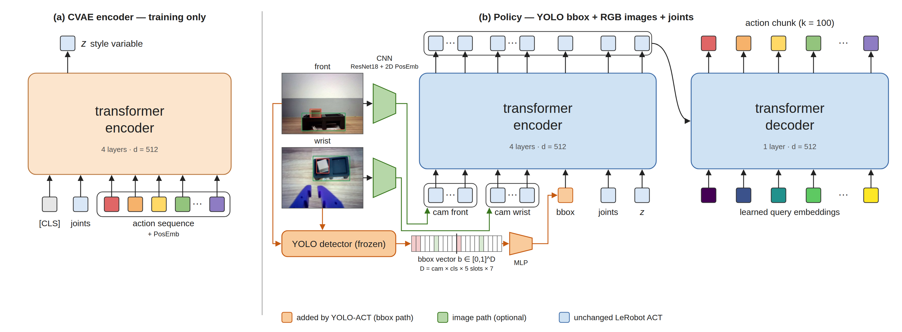
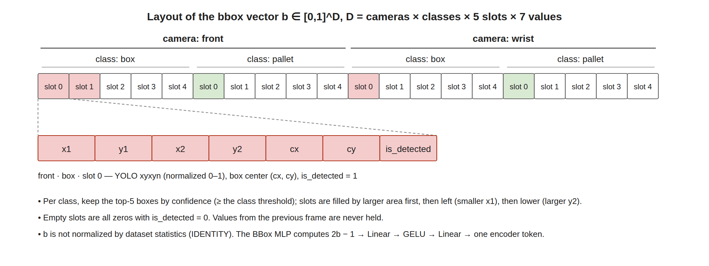
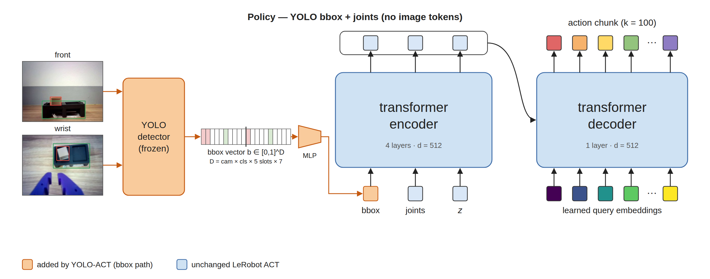

# YOLO-ACT: YOLO 검출 박스를 입력으로 받는 Action Chunking Transformer

<p align="center">
  
</p>

**그림 1.** YOLO-ACT 구조 (영상 + bbox + 관절). **(a)** 학습 때만 쓰는 CVAE 인코더는 LeRobot ACT 그대로다. 관절과 행동 시퀀스를 스타일 변수 *z* 로 압축하며, bbox 는 넣지 않는다. **(b)** 정책. 카메라 영상은 ResNet18 특징 지도 토큰이 된다. 같은 영상에서 동결된 YOLO 가 낸 박스는 고정 길이 bbox 벡터 *b* 로 바뀐 뒤 BBox MLP 를 거쳐 **인코더 토큰 1개**가 된다. 디코더는 학습되는 쿼리 *k* = 100 개로 행동 청크를 낸다. 추론 때는 *z* = 0 이다. 사진은 실제 녹화 데이터의 한 프레임이고, 그 위의 상자는 그 프레임에 **저장된 bbox 값**을 다시 그린 것이다 (빨강 box, 초록 pallet).

---

## 개요

ACT(Action Chunking Transformer)는 카메라 영상과 관절값만으로 행동을 배운다. 그래서 물체가 어디 있는지를 영상에서 스스로 찾아야 하고, 그만큼 데이터와 학습 시간이 든다. **YOLO-ACT** 는 미리 학습해 둔 YOLO 검출기가 매 프레임 낸 바운딩 박스를 ACT 의 입력으로 함께 넣는다. 물체의 위치를 명시적인 저차원 신호로 주는 것이다.

이 저장소는 [LeRobot](https://github.com/huggingface/lerobot) 0.6.0 의 **플러그인**이다. 설치하면 LeRobot 의 학습 명령이 정책 `act_bbox` 를 그대로 인식하고, 녹화와 추론에는 bbox 를 함께 다루는 명령 두 개가 생긴다.

| 단계 | 명령 | 하는 일 |
|------|------|---------|
| 녹화 | `lerobot-record-bbox` | `lerobot-record` 와 옵션이 같다. 매 프레임 YOLO bbox 를 `observation.environment_state` 로 함께 기록한다 |
| 학습 | `lerobot-train --policy.type=act_bbox` | 수정하지 않은 LeRobot 학습 명령 |
| 추론 | `lerobot-rollout-bbox` | `lerobot-rollout` 과 옵션이 같다. 녹화 때와 같은 YOLO 설정으로 bbox 를 넣어 정책을 실행한다 |

**핵심 설계**

- **고정 길이 bbox 표현.** 카메라 × 클래스마다 박스 칸 5개를 두고, 칸마다 `x1, y1, x2, y2, cx, cy, is_detected` 를 둔다. 칸 순서가 정해져 있어 칸의 위치가 곧 클래스와 순번이다 ([그림 3](#1-bbox-표현)).
- **BBox 인코더.** ACT 의 환경 상태 입력층(`Linear`)을 `2b − 1 → Linear → GELU → Linear` MLP 로 바꿨다. 나머지 ACT 구조와 손실은 그대로다.
- **학습과 추론의 같은 bbox.** 녹화 때의 YOLO 설정(가중치 sha256 · 카메라 · 클래스 · 클래스별 conf · 색 순서)을 데이터셋과 체크포인트에 기록한다. 추론은 그 설정으로 같은 계산을 한다.
- **두 가지 입력 구성.** 영상 + bbox + 관절 (그림 1), 그리고 영상 없이 bbox + 관절 ([그림 2](#2-정책-구조)).

---

## 방법

### 1. bbox 표현

<p align="center">
  
</p>

**그림 3.** bbox 벡터 배치. 예는 카메라 2대 × 클래스 2개라서 *D* = 2 × 2 × 5 × 7 = 140 이다. 칸 하나는 YOLO 의 정규화 좌표(`xyxyn`, 0~1)와 중심, 검출 여부 7개 값이다.

| 항목 | 내용 |
|------|------|
| 키 | `observation.environment_state` |
| 이름 | `{camera}_{class}{slot}_{field}` (예: `front_box0_x1`, `wrist_pallet4_is_detected`). 카메라 → 클래스 → 칸 → 필드 순서 |
| 좌표 | YOLO 가 내보내는 0~1 정규화 값 그대로(`xyxyn`). 중심 `cx, cy` 를 함께 넣는다 |
| 고르기 | 클래스마다 **그 클래스의 conf 하한** 이상인 박스 중 confidence 상위 5개 |
| 칸 순서 | 넓이가 큰 박스부터 칸 0, 1, …. 넓이가 같으면 왼쪽(`x1` 작은) 것, 그다음 아래(`y2` 큰) 것부터 |
| 빈 칸 | 모두 0, `is_detected = 0`. 이전 프레임 값을 유지하지 않는다 |
| 클래스 값 | 따로 넣지 않는다. 칸이 클래스별로 나뉘어 있어 칸 위치가 곧 클래스다 |

### 2. 정책 구조

<p align="center">
  
</p>

**그림 2.** bbox + 관절 구성. 인코더에는 bbox 토큰 1개, 관절 토큰 1개, *z* 토큰 1개만 들어간다. 영상은 YOLO 를 돌릴 때만 쓰이고 ResNet 을 거치지 않는다. CVAE 인코더는 그림 1(a)와 같다.

`act_bbox` 는 LeRobot `ACTPolicy` 를 상속하고, 환경 상태 입력층 하나만 바꾼다 ([`modeling_act_bbox.py`](src/lerobot_policy_act_bbox/modeling_act_bbox.py)).

| 구성 | 인코더 입력 토큰 | 학습 데이터셋 |
|------|------------------|---------------|
| 영상 + bbox + 관절 (그림 1) | 카메라마다 ResNet18 특징 지도 15 × 20 = 300개 (480 × 640 입력) + bbox 1 + 관절 1 + *z* 1 | 녹화한 그대로 |
| bbox + 관절 (그림 2) | bbox 1 + 관절 1 + *z* 1 | 녹화한 데이터셋에서 영상 특징을 뺀 것 |
| 영상 + 관절 (비교용 ACT) | 카메라마다 300개 + 관절 1 + *z* 1 | 녹화한 데이터셋에서 bbox 를 뺀 것 (`--policy.type=act`) |

공통 설정은 LeRobot ACT 기본값이다. 인코더 4층, 디코더 1층, CVAE 인코더 4층, *d* = 512, 청크 *k* = 100, KL 가중치 10, L1 손실이다.

### 3. 정규화

관절과 행동은 데이터셋 평균 · 표준편차로 정규화한다. **bbox 는 정규화하지 않는다** (`ENV: IDENTITY`). 검출률이 높으면 `is_detected` 의 표준편차가 0 에 가까워지는데, 이때 정규화하면 미검출(0)이 −14 같은 큰 값으로 튄다. bbox 는 이미 0~1 이므로 BBox 인코더가 `2b − 1` 로 [−1, 1] 에 맞춘다.

### 4. 학습과 추론에서 같은 bbox

같은 정책이라도 YOLO 설정이 바뀌면 bbox 값의 분포가 달라진다. 그래서 다음 규칙을 지킨다.

- 녹화할 때 YOLO 설정을 데이터셋 특징의 `info.bbox_detector` 에 남긴다. 가중치 경로 · sha256, 카메라, 클래스, `conf`(가장 낮은 하한), `class_conf`(클래스별 하한), 색 순서다.
- 학습할 때 그 설정을 체크포인트(`config.json` 의 `bbox_*`)로 복사한다.
- 추론할 때 체크포인트 설정을 기본으로 쓴다. 클래스별 하한(`class_conf`)은 체크포인트를 학습한 데이터셋이 로컬에 있으면 거기서 읽는다. 단, 클래스 · 카메라 · 가중치 sha256 · `conf` 가 체크포인트와 모두 같을 때만 쓰고, 아니면 모든 클래스에 `conf` 를 쓴다.
- 가중치 파일이 녹화 때와 다르거나(sha256), 명령줄로 설정을 바꾸면 제어 루프 직전에 경고한다. 카메라 · 클래스 순서가 달라 bbox 이름이 어긋나면 시작하지 않는다.

---

## 설치

LeRobot 0.6.0 과 [Ultralytics](https://github.com/ultralytics/ultralytics) 가 깔린 Python 3.12 환경에서 설치한다.

```bash
git clone https://github.com/<계정>/YOLO-ACT.git
cd YOLO-ACT
pip install -e . --no-deps --no-build-isolation
```

- LeRobot 과 Ultralytics 는 이 패키지가 설치하지 않는다 (`dependencies = []`). 이미 쓰는 환경을 그대로 쓰기 위해서다.
- 설치하면 모든 `lerobot-*` 명령이 이 패키지를 플러그인으로 자동으로 불러온다. LeRobot 은 이름이 `lerobot_policy_` 로 시작하는 패키지를 찾는다.
- 지울 때는 `pip uninstall lerobot_policy_act_bbox` 를 실행한다.

---

## 사용법

### 1. 녹화

```bash
lerobot-record-bbox \
  --robot.type=so101_follower --robot.port=/dev/ttyACM0 --robot.id=follower \
  --robot.cameras="{front: {type: opencv, index_or_path: 0, width: 640, height: 480, fps: 30}, wrist: {type: opencv, index_or_path: 2, width: 640, height: 480, fps: 30}}" \
  --teleop.type=so101_leader --teleop.port=/dev/ttyACM1 --teleop.id=leader \
  --dataset.repo_id=${HF_USER}/pick_box --dataset.single_task="Pick up the box" --dataset.num_episodes=50 \
  --bbox.model=path/to/best.pt --bbox.class_conf='[0.8,0.8]'
```

| 옵션 | 기본값 | 설명 |
|------|--------|------|
| `--bbox.model` | (필수) | YOLO 가중치 `.pt` |
| `--bbox.cameras` | `--robot.cameras` 전부, 그 순서 | 예: `'[front,wrist]'` |
| `--bbox.classes` | 모델 클래스 전부(번호 순) | 예: `'[box,pallet]'`. 이 순서대로 칸이 놓인다 |
| `--bbox.conf` | 0.3 | 모든 클래스에 쓰는 confidence 하한 |
| `--bbox.class_conf` | (없음) | 클래스별 하한, `--bbox.classes` 순서. 예: `'[0.9,0.8]'`. 주면 `--bbox.conf` 대신 쓴다 |
| `--bbox.device` | Ultralytics 자동 선택 | 예: `cuda`, `cpu` |
| `--bbox.is_bgr_input` | false | 카메라 프레임이 이미 BGR 일 때만 true ([주의](#제약과-주의)) |

- **실시간 검사.** 녹화를 시작하기 전에 카메라 수만큼 묶어 YOLO 지연을 잰다. 지연이 한 주기(1/`--dataset.fps`)의 70% 를 넘으면 로봇에 연결하지 않고 멈춘다. 느린 채로 녹화하면 프레임이 모자라는데, LeRobot 은 timestamp 를 `frame_index / fps` 로 적으므로 **데이터셋의 시간이 조용히 압축된다**. 그 데이터로 학습한 정책은 시연보다 빨리 움직인다. CPU 에서 막히면 `--dataset.fps` 를 낮추거나 GPU 를 쓴다.
- **이어 녹화**(`--resume=true`)는 YOLO 설정이 처음 녹화와 같을 때만 된다. 가중치 sha256, 클래스, `conf`, `class_conf`, 색 순서, 카메라를 비교한다.
- 에피소드가 끝날 때마다 검출률과 YOLO 지연을 로그로 남긴다. 검출률이 낮으면 시연을 더 쌓기 전에 YOLO 부터 개선한다.

```
[episode] bbox: 1800 frames | 검출 front box 91% front pallet 93% wrist box 91% wrist pallet 91% | yolo p50 12.5 ms p95 17.6 ms
```

### 2. 학습

한 번 녹화한 데이터셋에서 입력 구성별 데이터셋을 만든다. 비교용 ACT 를 학습할 때는 bbox 를 **반드시** 빼야 한다. 그대로 두면 일반 `act` 도 `observation.environment_state` 를 입력으로 써 버린다.

```bash
# bbox + 관절 (그림 2): 영상 제거
lerobot-edit-dataset --repo_id=${HF_USER}/pick_box --new_repo_id=${HF_USER}/pick_box_noimg \
  --operation.type=remove_feature --operation.feature_names='["observation.images.front","observation.images.wrist"]'
# 영상 + 관절 (비교용 ACT): bbox 제거
lerobot-edit-dataset --repo_id=${HF_USER}/pick_box --new_repo_id=${HF_USER}/pick_box_nobbox \
  --operation.type=remove_feature --operation.feature_names='["observation.environment_state"]'
```

```bash
# 영상 + bbox + 관절 (그림 1)
lerobot-train --dataset.repo_id=${HF_USER}/pick_box --policy.type=act_bbox \
  --output_dir=outputs/train/act_bbox_pick_box --job_name=act_bbox_pick_box \
  --policy.device=cuda --policy.push_to_hub=false

# bbox + 관절 (그림 2)
lerobot-train --dataset.repo_id=${HF_USER}/pick_box_noimg --policy.type=act_bbox \
  --output_dir=outputs/train/act_bbox_noimg --job_name=act_bbox_noimg \
  --policy.device=cuda --policy.push_to_hub=false

# 영상 + 관절 (비교용 ACT)
lerobot-train --dataset.repo_id=${HF_USER}/pick_box_nobbox --policy.type=act \
  --output_dir=outputs/train/act_nobbox --job_name=act_nobbox \
  --policy.device=cuda --policy.push_to_hub=false
```

- `act_bbox` 는 `observation.environment_state`(bbox) 입력이 없는 데이터셋으로는 시작하지 않는다.
- `--policy.repo_id` 를 주면 학습이 끝날 때 모델을 Hugging Face Hub 에 올린다. 올리지 않으려면 `--policy.push_to_hub=false` 를 준다.
- LeRobot 0.6.0 에는 `--trackio.enable` 옵션이 없다. 기록이 필요하면 `--wandb.enable=true` 를 쓴다.
- `--dataset.eval_split` 은 무작위로 나누지 않고 마지막 10% 에피소드를 검증으로 쓴다.

### 3. 추론

```bash
lerobot-rollout-bbox --strategy.type=base \
  --policy.path=outputs/train/act_bbox_pick_box/checkpoints/last/pretrained_model \
  --robot.type=so101_follower --robot.port=/dev/ttyACM0 --robot.id=follower \
  --robot.cameras="{front: {...}, wrist: {...}}" \
  --task="Pick up the box" --duration=60
```

- **카메라 이름**이 녹화 때와 같아야 한다. 다르면 로봇에 연결하기 전에 멈춘다.
- **YOLO 설정**은 [방법 4](#4-학습과-추론에서-같은-bbox) 대로 정해진다. `--bbox.*` 로 바꿀 수는 있지만 학습 때와 다르면 경고한다. `--bbox.conf` 를 주면 그 값을 모든 클래스에 쓴다.
- **가중치 경로.** 데이터셋과 체크포인트에는 YOLO 가중치의 절대 경로가 저장된다. 다른 PC 에서는 `--bbox.model` 로 경로를 지정한다. Hub 에 올리면 이 경로도 함께 올라간다.
- **녹화하며 평가**하려면 `--strategy.type=episodic --dataset.repo_id=${HF_USER}/rollout_pick_box ...` 로 실행한다. LeRobot 규칙상 데이터셋 이름이 `rollout_` 으로 시작해야 한다.
- 일반 `lerobot-rollout` 으로 실행하면 bbox 가 들어가지 않아 첫 추론에서 멈추고, 이 명령을 쓰라는 오류를 낸다.
- `--inference.type=rtc` 는 지원하지 않는다. bbox 는 sync 추론에서만 정책에 들어간다.

---

## 제약과 주의

- **LeKiwi.** LeRobot 0.6.0 은 LeKiwi 를 CLI 가 아니라 `examples/lekiwi/*.py` 스크립트로 녹화 · 평가한다. CLI 의 텔레오퍼레이터 옵션으로는 "리더 팔 + 키보드(바퀴)" 조합을 넣을 수 없고, `lerobot-rollout` 은 `.pos` 관절만 정책에 연결해 바퀴(`.vel`)를 구동하지 못한다. 그래서 이 패키지의 녹화 · 추론 명령은 so101_follower 처럼 텔레오퍼레이터가 하나인 로봇용이다. 학습(`act_bbox`)과 bbox 계산 단계(`YoloBBoxStep`)는 로봇과 무관하다.
- **색 순서.** LeRobot 카메라는 RGB 를 주고, Ultralytics 는 numpy 입력을 BGR 로 읽는다. 그래서 기본으로 RGB → BGR 로 바꿔 넣는다. 프레임이 이미 BGR 로 들어오는 경우(ROS 호스트에 `lekiwi_client` 로 붙은 LeKiwi 등)에만 `--bbox.is_bgr_input=true` 를 준다. 색을 틀렸을 때 box 모델의 검출률이 학습 이미지 기준 99% 에서 91% 로 떨어졌다.
- **실행 속도.** YOLO 는 대기열 없이 제어 주기 안에서 카메라를 묶어 한 번에 추론한다. 늘 최신 프레임을 쓰고 지연이 쌓이지 않는 대신, 지연이 그대로 제어 주기에 더해진다. RTX 5070 Ti Laptop GPU 에서 카메라 2대 기준 YOLO 지연은 p50 약 10~13 ms 였고, ACT 를 포함한 롤아웃은 약 29 Hz 로 돌았다. 녹화 · 추론 전에 한 번 예열한다 (첫 추론은 CUDA 초기화로 약 3초 걸린다).

---

## 시험

```bash
python -m pytest
```

- 시험은 63개이고 GPU 에서 약 2분 걸린다.
- 통합 시험(`tests/test_cli.py`)은 가짜 로봇(`tests/fake_hw`)으로 녹화 → 데이터셋 파생 → `lerobot-train` → 롤아웃을 끝까지 돌린다. CUDA, box · pallet 두 클래스를 검출하는 YOLO 가중치, 그 학습 이미지 폴더가 필요하고, 없으면 건너뛴다. 경로는 환경 변수 `YOLO_ACT_TEST_WEIGHTS` · `YOLO_ACT_TEST_IMAGES` 로 지정한다.

---

## 저장소 구조

```
src/lerobot_policy_act_bbox/
  bbox.py                    YOLO 탐지, bbox 처리 단계, 데이터셋 특징, 실시간 검사
  configuration_act_bbox.py  act_bbox 설정 (bbox 필수, 녹화 때 YOLO 설정 저장)
  modeling_act_bbox.py       act_bbox 정책 (BBox 인코더 MLP)
  processor_act_bbox.py      act_bbox 처리기 (ACT 와 같음)
  record.py, rollout.py      lerobot-record-bbox, lerobot-rollout-bbox
  lerobot_hooks.py           LeRobot 0.6.0 내부 함수를 이 프로세스 안에서만 감싸기
tests/                       단위 시험, 통합 시험, 가짜 로봇
docs/figures/                README 그림 (SVG 원본 + PNG)
```

---

## 인용

이 저장소를 사용했다면 다음과 같이 인용할 수 있다.

```bibtex
@misc{yolo_act,
  title        = {YOLO-ACT: Action Chunking Transformer with YOLO Bounding-Box Inputs},
  author       = {<저자>},
  year         = {2026},
  howpublished = {\url{https://github.com/<계정>/YOLO-ACT}}
}
```

YOLO-ACT 는 다음 연구와 코드 위에 만들었다.

```bibtex
@article{zhao2023learning,
  title   = {Learning fine-grained bimanual manipulation with low-cost hardware},
  author  = {Zhao, Tony Z and Kumar, Vikash and Levine, Sergey and Finn, Chelsea},
  journal = {arXiv preprint arXiv:2304.13705},
  year    = {2023}
}

@misc{cadene2024lerobot,
  author       = {Cadene, Remi and Alibert, Simon and Soare, Alexander and Gallouedec, Quentin and Zouitine, Adil and Palma, Steven and Kooijmans, Pepijn and Aractingi, Michel and Shukor, Mustafa and Aubakirova, Dana and Russi, Martino and Capuano, Francesco and Pascal, Caroline and Choghari, Jade and Meftah, Khalil and Ellerbach, Maxime and Moss, Jess and Wolf, Thomas},
  title        = {LeRobot: State-of-the-art Machine Learning for Real-World Robotics in Pytorch},
  howpublished = "\url{https://github.com/huggingface/lerobot}",
  year         = {2024}
}
```

---

## 라이선스

이 저장소의 코드는 [Apache License 2.0](LICENSE) 을 따른다. LeRobot 과 같은 라이선스다.

실행에 필요한 Ultralytics 는 이 저장소에 포함하지 않으며, **AGPL-3.0** (또는 Ultralytics Enterprise 라이선스)을 따른다. Ultralytics 와 함께 배포하거나 서비스할 때는 그 라이선스 조건을 확인해야 한다.

## 감사의 말

ACT 구조와 학습 · 추론 파이프라인은 [LeRobot](https://github.com/huggingface/lerobot) 의 구현을 그대로 쓰고, 물체 검출은 [Ultralytics YOLO](https://github.com/ultralytics/ultralytics) 를 쓴다. ACT 원 논문과 [ALOHA](https://tonyzhaozh.github.io/aloha) 프로젝트에 감사한다.
